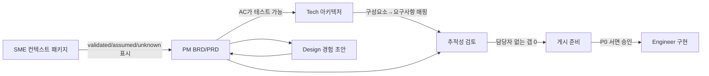

# 역할 경계 맵

## 1. 산출물 소유권 (Documented behavior 기반)

| 산출물 | 소유 역할 | 입력 제공 | 검토/승인 | 근거 |
|---|---|---|---|---|
| 컨텍스트 패키지 | SME | 정책, SOP, 증거 | 팀 | role-tracks Part 1 |
| Marketplace Lean Canvas | SME | 시장/비용 가정 | PM | role-tracks Part 1 |
| 리서치 아티팩트 (`/rpi-research`) | SME | 증거 자료 | 팀 | 동일 |
| BRD / PRD 초안 | PM | SME 컨텍스트 | 책임자 | 동일 ("PM이 소유") |
| 경험 초안, 여정, Pain Point | Design | SME 컨텍스트, 사용자 리서치 | PM | 동일 |
| 구현 계획 (`/rpi-plan`) | PM | BRD/PRD, 경험 초안 | 책임자 | Part 2 |
| MVP 백로그, GitHub Issues | PM | 계획 | 퍼실리테이터 승인 | Part 2, solution |
| 아키텍처 노트, 다이어그램 | Tech | 계획, PRD, 경험 | 팀 | Part 2 |
| 보안 위험 및 후속 조치 | Tech (Security Planner) | 아키텍처 | 책임자 | Part 2 |
| 추적 매트릭스 | 팀 (RPI-Plan) | 6개 폴더 | 책임자 | solution |
| 가격안 (`solution-monetization-plan.md`) | PM | 재무, 엔지니어링, 영업 | 재무 등 | publishing |
| 첫 P0 구현 승인 | PM 진행 + 책임 담당자 서면 승인 | 계획 | 사람 검토자 | implementation |
| 구현 변경 기록 | Engineer | 승인된 P0 | 사람 검토자 | implementation |

## 2. 경계 규칙 (문서에서 직접 도출)

1. **도메인 용어와 비즈니스 규칙의 기준은 SME 컨텍스트 팩**이다. 파일 간 모순은 이 기준으로 푼다.
2. PM은 **초안을 소유**하지만 근거는 SME가 제공한다. PM이 근거를 새로 만들지 않는다.
3. 에이전트 산출물은 책임자 검토 전까지 **초안**으로 표시한다.
4. **사람 검토 체크박스를 대신 체크하지 않는다.**
5. 이슈 생성은 퍼실리테이터 승인과 저장소 권한이 있을 때만 한다.
6. `Blocked`/`Not ready` 상태에서는 `/rpi-implement`를 시작하지 않는다.
7. 범위·아키텍처·보안·개인정보·RAI·가격·라이선스가 바뀌면 구현을 멈추고 계획으로 돌아간다.

## 3. 겸직 시 충돌 지점 (Technical inference)

| 충돌 | 설명 | 통제 |
|---|---|---|
| SME가 쓴 컨텍스트를 PM으로서 본인이 BRD화 | 자기 가정이 사실로 굳음 | [[PM-SME-Dual-Hat-Controls]] |
| 가격 소유자 + 주제 제안자 | 낙관 편향 | 재무/영업 검토 필수, 가정 표시 |
| 추적성 검토 + 산출물 작성자 | 자기 검토 | `/rpi-challenger`, 다른 역할이 서명 |

## 4. 인계(Handoff) 조건

각 화살표의 통과 조건은 해당 역할 문서의 "Exit criteria"를 본다.

---

## 업데이트 2026-11-03: Declarative agent + 백엔드 프로젝트 기준
- 기술 트랙을 Architect(설계)와 Tech Lead(전달·승인)로 분리한 배정은 [[RACI-Matrix]], 경계별 인계 조건은 [[Handoff-Interfaces]], 작업 분해는 [[Backend-Work-Breakdown]]를 본다.
- 위 1절의 "아키텍처 노트, 다이어그램 | Tech" 행은 Architect(R), Tech Lead(A)로 읽는다.
- 첫 P0 구현 승인은 PM이 진행하고 Tech Lead가 서면 승인한다.

인터페이스 전체 구조도: [[Interface-Structure-Map]]
