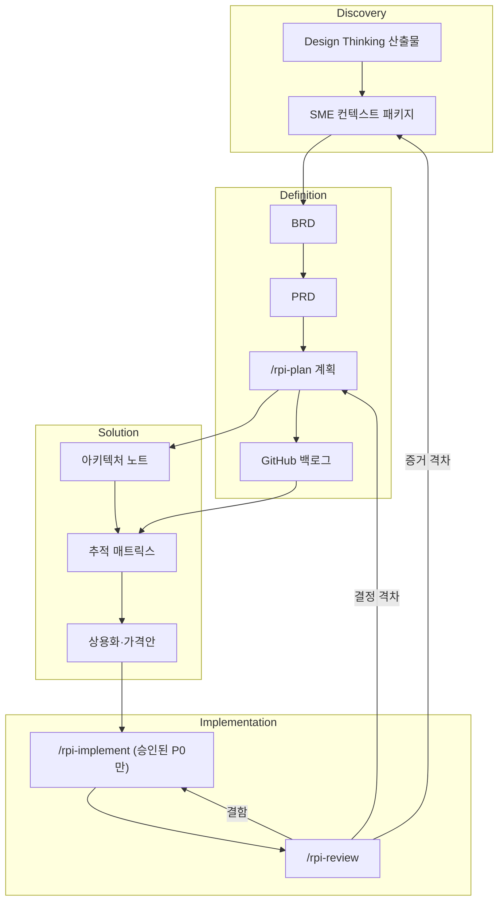

# 프로그램 개요

## 정의 (Documented)
- HVE = Hypervelocity **Engineering**, Hypervelocity Innovation 내부의 가속화 레이어
- 방법론: Design Thinking(발견) + RPI(Research, Plan, Implement, Review)
- 도구: HVE Core (도구, 프롬프트, 에이전트, 검증 규칙). GitHub Copilot + VS Code에서 실행
- README의 자기 규정: "매우 주관적이고 빠르게 진화하는" 프레임워크. 안정 플랫폼이 아니라 **패턴과 학습의 원천**으로 취급

## 일정 (총 약 4시간 30분)

| # | 단계 | 시간 | 주 책임 |
|---|---|---|---|
| 1 | 개요 | 30분 | 퍼실리테이터, PM |
| 2 | 환경 설정(로컬 VS Code) | 30분 | Tech 리드 |
| 3-1 | 역할 트랙 Part 1: SME / PM / Design | 45분 | 각 트랙 |
| 3-2 | 역할 트랙 Part 2: 백로그 / 아키텍처 | 45분 | PM / Tech |
| 4 | 검증 및 솔루션 | 30분 | 전원 |
| 5 | Marketplace / Agent Store 준비 | 60분 | PM, Tech |
| 6 | 구현·상용화 핸드오프 | 30분 | PM, Engineer |

## 완료 기준 (Documented)
- 6개 초안 산출물 검토 완료
- 미해결 가정 식별
- 게시 후속 조치마다 담당자 지정

**워크샵이 아닌 것**: 문서는 운영 보안 검토, Azure 배포, Marketplace 인증을 하루에 끝내는 과정이 아니라고 명시한다. 실제 배포와 인증, Agent Store 출시 가능 여부는 워크샵 이후 마일스톤이다.

## 데이터 흐름

## 핵심 주의 (Documented)
HVE Core의 커스텀 에이전트는 GitHub Copilot과 VS Code에서 동작하며 **Microsoft 365 Copilot 에이전트가 아니다.** 따라서 Agent Store에 그대로 올릴 수 없고, 고객 대면 에이전트는 지원되는 M365 에이전트 도구로 별도로 만든다. 즉 워크샵에서 쓰는 도구와 게시하는 제품은 별개다.
