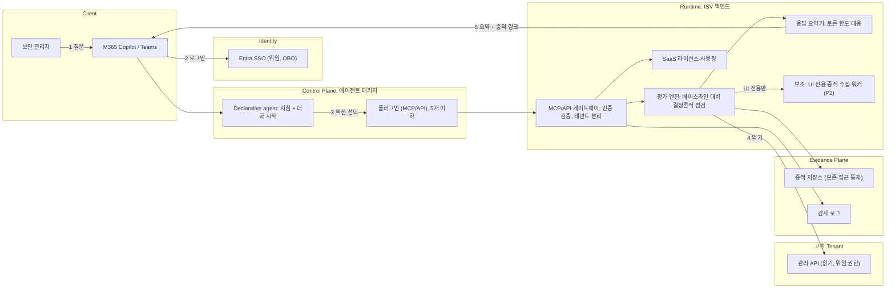

# 백엔드 + Declarative agent 작업 분해

> 이 문서의 구조(작업 패키지, 마일스톤)는 제안이다. HVE 문서는 P0의 정의와 우선순위 기준을 두지 않으며("가볍고 결과 중심으로"), 구현은 워크샵 이후 마일스톤이다.

## 1. 개념 아키텍처 (미검증, 인프라 소스 없음)

Enforcement Point: 테넌트 변경 권한은 로그인 사용자의 위임 권한과 고객 RBAC가 가진다 (MVP는 읽기 전용이라 변경 없음).

## 2. 작업 패키지 (WP)

| WP | 작업 | 산출물 | 마일스톤 |
|---|---|---|---|
| WP1 | 통제 카탈로그와 베이스라인 정의: 범위에 넣을 Tenant MW 보안 설정, 기대값, "정책 존재 / 적용 / enforcement" 증적 정의 | 통제 카탈로그 (SME 컨텍스트 패키지) | 워크샵 |
| WP2 | API/UI 커버리지 표 확정 (읽기 가능 여부, 필요 권한, GA/Preview) | [[API-vs-UI-Coverage]] | 워크샵 후 즉시 |
| WP3 | 솔루션 아키텍처, 신뢰 경계, 데이터 흐름 | 아키텍처 노트, ADR | 워크샵 |
| WP4 | 인증·동의 설계 (Entra SSO/OBO, 최소 권한, 테넌트 관리자 승인 절차) | ADR, 앱 등록 사양 | 워크샵 → P0 |
| WP5 | 플러그인 표면 설계: 함수 10개 이하, 굵은 단위 | OpenAPI/도구 정의 | P0 |
| WP6 | 평가 엔진과 증적 스키마 | 스키마, 규칙 구현 | P0 |
| WP7 | Graph 등 관리 API 읽기 연동 (WP2 결과 기반) | 커넥터 | P0 |
| WP8 | 응답 요약기: 큰 증적은 저장소 링크, Copilot에는 요약 | 요약 규칙 | P0 |
| WP9 | Declarative agent 패키지: 지침, 가드레일, 매니페스트, 아이콘 | 앱 패키지 | P0 |
| WP10 | 멀티테넌트 분리, 보존, 로깅, 비밀 관리 | 설계 + 구현 | P1 |
| WP11 | SaaS 오퍼·라이선스 연동 (fulfillment, 랜딩), 가격 권장안 | 오퍼, 상용화 계획 | P1 |
| WP12 | 검증: 스토어 검증 가이드라인, RAI 검증, 보안 검토 | 체크리스트 결과 | P1 |
| WP13 | 테스트: Positive/Negative Path, 프롬프트 인젝션 시나리오 | 테스트 세트 | P0 → P1 |
| WP14 | 리스팅, 프라이버시 성명, 이용 약관, 지원 정보, 고객 설정 안내 | 게시 문서 | P1 |
| WP15 | 개발 환경: Copilot 라이선스 테넌트, 사이드로드 권한, Partner Center 등록 | 환경 준비 확인 | 워크샵 전 |
| WP16 | UI 전용 증적 수집 워커 (Playwright 등), 범위 제한 | 워커 | P2 |
| WP17 | 쓰기(적용) 기능: 승인, 롤백, 사후 검증 | 별도 설계 | 비목표 (후속) |

## 3. 마일스톤 (제안)

| 단계 | 정의 | 완료 증거 |
|---|---|---|
| 워크샵 | BRD/PRD, 백로그, 아키텍처 노트, 게시 계획 초안 (HVE 문서의 산출물) | 6개 초안 검토, 미해결 가정 식별, 담당자 지정 |
| P0 | 설정 1~2개로 **세로 슬라이스**: Copilot 질문 → 플러그인 → 백엔드 → 읽기 → 요약+증적 링크 | 사이드로드 테넌트에서 Positive/Negative 경로 통과 |
| P1 | 범위 확대, 멀티테넌트 분리, SaaS 연동, 검증 가이드라인·RAI 점검, 게시 문서 | 검증 체크리스트 통과, 제출 가능 상태 |
| P2 | UI 전용 증적 수집 워커 | 항목별 필요성이 WP2로 입증된 경우만 |
| 후속 | 쓰기 기능, Custom engine 검토 | 별도 결정 |

HVE 규칙(Documented): `Blocked`/`Not ready`면 `/rpi-implement` 금지, 첫 P0 작업은 책임 담당자의 서면 승인 후 한 번에 한 작업씩 구현, 범위·아키텍처·보안·개인정보·RAI·가격·라이선스가 바뀌면 중단하고 계획으로 복귀.

## 4. 엔지니어링 체크리스트 (Microsoft Learn, Documented)
- 도구: Microsoft 365 Agents Toolkit(VS Code), Node.js 20.x 또는 22.x. OpenAPI 설명이 있으면 Kiota로 플러그인 패키지 생성 가능.
- 플러그인 인증: Entra SSO, OAuth 2.0 authorization code, API key(API 플러그인만), 익명(개발용). MCP 플러그인은 API key 미지원.
- Entra SSO(OBO) 사용 시: 필요한 동의가 없으면 401을 반환해 동의 프롬프트를 유도, Application ID URI를 `identifierUris`에 추가, 지정된 리디렉션 URI와 Microsoft Enterprise token store 클라이언트 ID를 허용 클라이언트로 등록.
- 스토어 검증: SSO 사용 시 Office 앱 클라이언트 ID를 Authorized client applications에 추가, Teams 데스크톱/웹, copilot.microsoft.com, Word의 M365 Copilot에서 동작.
- 설계 제한: 플러그인 5개 초과 시 설명 기반 매칭, 함수·도구 10개 초과 시 품질 저하 가능, 큰 응답은 토큰 한도로 잘림.
- 사이드로드: 계정에 Custom App Upload Enabled와 Copilot Access Enabled 필요.

관련: [[RACI-Matrix]], [[Handoff-Interfaces]], [[Decision-002-Agent-Type-Declarative]]

---

## 업데이트 2026-11-03: 제한 환경 대응 작업 추가
| WP | 작업 | 산출물 | 마일스톤 |
|---|---|---|---|
| WP18 | 제한 환경 카탈로그와 관찰 사실 등록 (SME) | [[SME-Observation-Register]], [[Restricted-Environment-Strategy]] | 워크샵 |
| WP19 | 운영 모드(A/B/C)와 백엔드 ingress 설계, 정적 egress IP 추적 | ADR, 설계 | P0 → P1 |
| WP20 | 고객 준비도 체크리스트와 관리자 승인 패키지 | [[Customer-Readiness-Checklist]] | P1 |
| WP21 | 수집기(고객 경계 내 아웃바운드 전용) | 수집기 | P2 |
