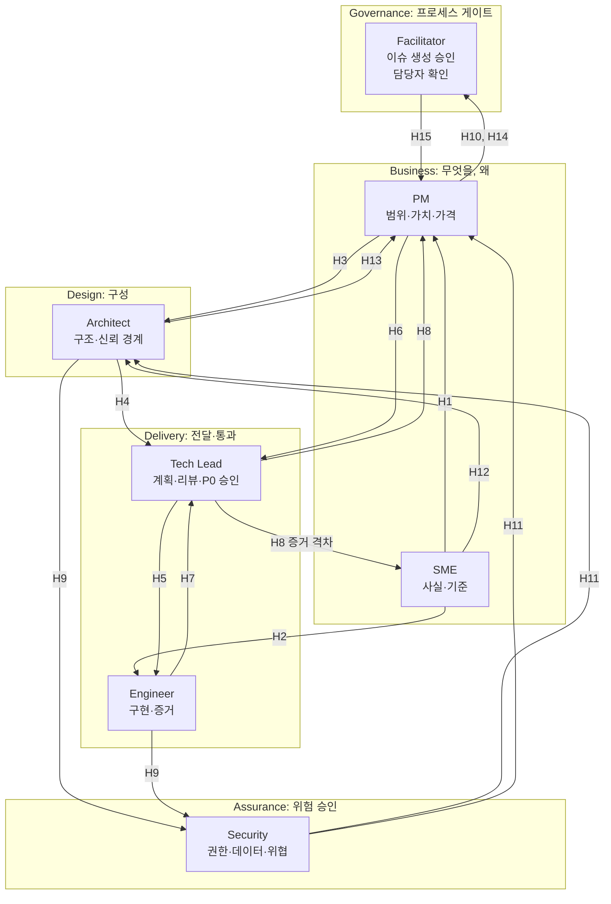
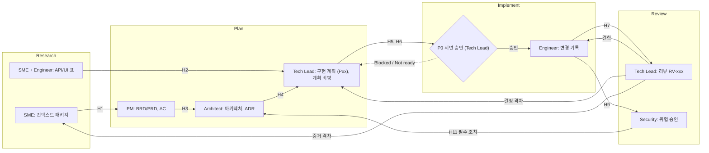

# 역할 경계 인터페이스 구조도

각 역할의 **핵심 경계**와 경계를 잇는 **인터페이스(H-ID)**를 한 장으로 본다. 인계 조건의 상세는 [[Handoff-Interfaces]], 담당 배정은 [[RACI-Matrix]]를 본다. 경계 분리(Architect와 Tech Lead 등)는 Vault의 제안이며 HVE 문서는 Tech Lead와 Architect를 한 역할로 둔다.

## 1. 역할 인터페이스 구조도

H-ID의 정의와 산출물은 아래 6절 표와 [[Handoff-Interfaces]]에 있다. 화살표 방향은 **산출물이 흐르는 방향**이고, 승인은 해당 역할이 `gate.approved`를 사람이 설정한다.

## 2. 역할별 핵심 경계 요약

| 역할 | 핵심 경계(소유) | 제공하는 인터페이스 | 소비하는 인터페이스 | 경계 규칙 |
|---|---|---|---|---|
| **SME** | 사실과 기준 | H1, H2, H12 | H8(증거 격차) | 사실·가정·결정·미해결 분리, 신뢰도 표시. 요구사항·설계를 소유하지 않는다 |
| **PM** | 범위·가치·상용화 | H3, H6, H10, H14 | H1, H8, H11, H13, H15 | 근거를 새로 만들지 않는다. P0는 직접 승인하지 않는다 |
| **Architect** | 구조와 신뢰 경계 | H4, H9, H13 | H3, H12, H11 | 일정·우선순위를 정하지 않는다. ADR 서명 A는 Tech Lead |
| **Tech Lead** | 전달·승인 | H5, H8 | H4, H6, H7 | 범위·가격 변경을 결정하지 않는다. 변경 발생 시 구현 중단 후 계획 복귀 |
| **Engineer** | 구현과 증거 | H7, H9 | H5, H2 | 승인된 P0만, 증거 있을 때만 체크 완료. 설계·범위를 바꾸지 않는다 |
| **Security** | 위험 승인 | H11 | H9 | 구현하지 않는다. 권한·데이터·위협 검토 |
| **Facilitator** | 프로세스 게이트 | H15 | H10, H14 | 역할 범위는 HVE 문서에 상세 정의 없음 (Unknown) |

## 3. RPI 단계별 인터페이스와 되돌림

## 4. 기술 컴포넌트 경계와 소유 역할

역할 인터페이스가 어떤 **기술 경계**에서 일어나는지 매핑한다. 컴포넌트 구조는 [[Backend-Work-Breakdown]]의 개념도와 같다(미검증).

| 컴포넌트 | 경계 인터페이스 | 설계(R) / 승인(A) | 구현(R) | 규칙의 원천 | 변경 시 거치는 H |
|---|---|---|---|---|---|
| C1 Declarative agent 패키지 (지침, 매니페스트) | Copilot ↔ 에이전트 | PM(의도) / PM | Engineer | PM의 가드레일, SME의 용어 | H3, H8 |
| C2 플러그인 표면 (MCP 도구 10개 이하) | Copilot ↔ 백엔드 (정적 egress IP) | Architect / Tech Lead | Engineer | 문서 제약(5개/10개, 토큰 한도) | H4, H7 |
| C3 인증·동의 (Entra SSO/OBO) | 사용자 ↔ 백엔드 | Architect / Tech Lead | Engineer | Security 협의 필수 | H4, H9, H11 |
| C4 백엔드 게이트웨이 | C2 ↔ C5, C9 ↔ C4(아웃바운드) | Architect / Tech Lead | Engineer | 운영 모드 A/B | H4, H12 |
| C5 평가 엔진 | C4 ↔ C6, C8 | Architect(스키마) / Tech Lead | Engineer | SME의 통제 카탈로그·기대값 | H1, H4 |
| C6 관리 API 읽기 커넥터 | C5 ↔ 고객 Tenant | Architect / Tech Lead | Engineer | SME의 API/UI 표, 최소 권한 | H2, H9 |
| C7 응답 요약기 | C5 ↔ Copilot | Architect(규칙) / Tech Lead | Engineer | 토큰 한도, SME 용어 | H4 |
| C8 증적 저장소·감사 로그 | C5 ↔ 고객 SIEM | Architect / Tech Lead | Engineer | 보존·삭제 정책, Security | H9, H11 |
| C9 수집기 (고객 경계 안, P2) | 고객 경계 ↔ C4 | Architect / Tech Lead | Engineer | Security 필수 협의 | H9, H12 |
| C10 SaaS 라이선스·사용량 | C4 ↔ Partner Center | PM(가격) / PM | Engineer(연동) | 이중 청구 방지, 승인 공백 | H10 |

## 5. 경계 변경 통제 (제안)

| 변경 유형 | 제안할 수 있는 역할 | 승인(A) | 필수 협의 | 되돌아갈 곳 |
|---|---|---|---|---|
| 통제 카탈로그·기대값 | SME | SME | PM(범위 영향) | Research |
| 범위·AC·비목표 | PM | PM | Architect, Tech Lead | Plan |
| 플러그인 표면, 인증, 스키마 | Architect, Engineer | Tech Lead | Security(인증·데이터) | Plan, ADR |
| 구현 방식(범위 내) | Engineer | Tech Lead | – | Implement |
| 가격·라이선스 | PM | PM | 재무, Tech Lead(연동) | Plan |
| 운영 모드 (A/B/C) | Architect | Tech Lead | PM, Security, SME | Plan |

- 범위·아키텍처·보안·개인정보·RAI·가격·라이선스가 바뀌면 구현을 중단하고 계획으로 복귀한다 (HVE 구현 단계 규칙, Documented).
- 작성자와 승인자는 같은 사람이 아니다. 겸직이면 다른 참가자의 서명을 받는다.

## 6. 인터페이스 ID 대조

| ID | 정의 | 상세 |
|---|---|---|
| H1~H10 | 기존 인계 | [[Handoff-Interfaces]] |
| H11 | Security → Architect/PM: 위험 판정, 필수 조치, 제출 전 보안 승인 | 신규 |
| H12 | SME → Architect/Engineer: 제한 환경 R-ID와 운영 모드 입력 | 신규, [[Restricted-Environment-Strategy]] |
| H13 | Architect → PM: 타당성, 범위 영향 피드백 | 신규 |
| H14 | PM → Facilitator: 이슈 생성 승인 요청 | 신규 (HVE: 퍼실리테이터 승인 필요) |
| H15 | Facilitator → PM: 담당자·다음 리뷰 일정 확인 | 신규 |

## 7. Unknown
- 퍼실리테이터 역할의 정확한 범위 (H14, H15의 책임 범위)
- 린터가 `hve_role`, `gate` 같은 맞춤 frontmatter 필드를 허용하는지
- Security 파트타임 리뷰어의 승인 권한이 HVE에서 공식 게이트인지 (게시 전 승인 항목에는 포함됨)

관련: [[Handoff-Interfaces]], [[RACI-Matrix]], [[01_Role-Boundary-Map]]
