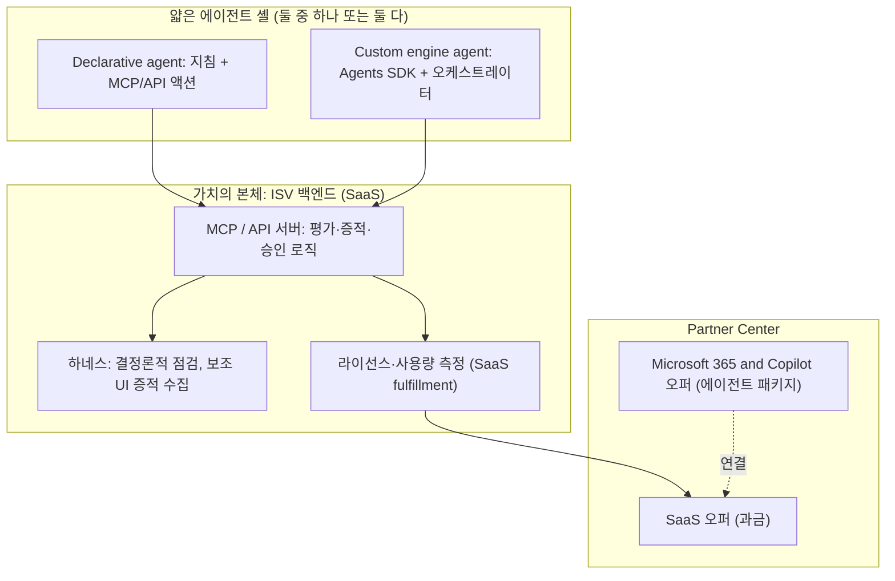

# D1: Declarative agent vs Custom engine agent

## 1. 결론 (초안, 최종 판단은 사용자)
1. **수익화는 에이전트 유형이 정하지 않는다.** Microsoft 365 and Copilot 에이전트는 두 유형 모두 *연결된 SaaS 오퍼*로 수익화한다. 백엔드(SaaS)가 필요한 점은 둘이 같다.
2. Custom engine은 백엔드를 없애 주지 않는다. **백엔드 위에 오케스트레이터 호스팅과 RAI 책임을 추가**한다.
3. Custom engine을 정당화하는 근거는 이 주제에서 두 가지다: 다단계 오케스트레이션, 선제 알림(드리프트 등).
4. 권고: **공통 백엔드(MCP/API)를 먼저 만들고, 에이전트는 얇은 셸로 둔다.** MVP에 선제 알림이 필요하면 Custom engine, 아니면 Declarative로 시작한다.

## 2. 문서로 확인된 비교 (Microsoft Learn)

| 항목 | Declarative | Custom engine |
|---|---|---|
| 구성 | 지침 + 지식 + 액션(MCP/API 플러그인) | 자체 orchestration + 자체 모델 |
| 호스팅 | Copilot이 호스팅, 추가 호스팅 없음 | M365 밖 호스팅(Azure 등), 추가 비용 |
| 컴플라이언스·RAI | M365 표준 상속 | 직접 보장 |
| 선제(proactive) 동작 | 미지원 (사용자 시작만) | 지원 |
| 사용 형태 | 개인 사용 설계 | 개인 + 그룹(Teams 채널·회의) |
| 채널 | M365 앱 안 | M365 + 외부 앱 |
| 사용자 라이선스 | Copilot 애드온 또는 Copilot Chat(적격 M365 라이선스) 필요 | Copilot 접근에 추가 라이선스 불필요 |
| 테넌트 데이터 접근 시 | 라이선스 없는 사용자는 Copilot Credits 종량 과금 가능 | 라이선스 없는 사용자는 종량 과금 가능 |
| 개발 도구 | Agents Toolkit, Agent Builder, Copilot Studio | Agents SDK(C#, JS, Python), Azure Bot Service 리소스, 앱 등록, 매니페스트 1.21 이상 |
| 상용 스토어 게시 | 가능 | 가능 |
| 수익화 | 연결된 SaaS 오퍼 | 연결된 SaaS 오퍼 |

출처: agents-overview, cost-considerations, overview-custom-engine-agent, bring-agents-to-copilot, partner-center `artificial-intelligence-app-agent-publish-release`.

## 3. 수익 구조 (Technical inference)

- 매출은 SaaS 오퍼(권한 부여, 사용량)에서 발생하고, 에이전트는 유통 채널이다.
- 규제 산업 고객이 많다면 테넌트 분리·데이터 상주 요구가 백엔드 설계에 먼저 걸린다 (D3).

## 4. Custom engine 정당화 점검 (Learn의 "Custom engine을 만들 때" 6개 기준)

| # | 기준 | 이 주제 |
|---|---|---|
| 1 | 복잡한 워크플로·정밀한 의사결정 규칙을 위한 맞춤 orchestration | **해당 가능**: 다단계 증적 수집, 승인 게이트, 검증 순서를 결정론적으로 통제 |
| 2 | 자체 모델 | 해당 없음 (결정론적 점검 중심) |
| 3 | 그룹 협업 (채널·회의) | 부분 해당: 보안팀 검토를 Teams 채널에서 |
| 4 | 기존 대화형 어시스턴트 통합 | 해당 없음 |
| 5 | M365 밖에서도 제공 | 부분 해당: CLI/IDE 병행 가능 |
| 6 | 선제 메시징 | **해당 가능**: 구성 드리프트·만료·정책 변경 알림 |

→ 1번과 6번이 근거다. 둘 다 MVP 범위에 실제로 들어가야 정당화가 성립한다.

## 5. 의사결정 규칙

| 조건 | 선택 |
|---|---|
| MVP = "Copilot에서 묻고 증적 기반 평가를 받는다" (사용자 시작) | Declarative |
| MVP에 정기 점검, 드리프트 알림, 채널 단위 협업이 필수 | Custom engine |
| 불확실 | 백엔드 먼저, Declarative로 검증 후 필요 시 Custom engine 추가 |

두 유형의 매니페스트 구조는 다르므로 서로 전환하는 경로가 문서에 명시돼 있지 않다(Unknown). 그래서 공통 백엔드에 가치를 두는 설계가 전환 비용을 줄인다.

## 6. 위험 비교

| 위험 | Declarative | Custom engine |
|---|---|---|
| RAI·보안 검증 부담 | M365가 상속 | **직접 부담** |
| 운영·호스팅 | 불필요(백엔드만) | 백엔드 + 오케스트레이터 + Bot Service |
| 비용 | 낮음 | Azure 호스팅, 모델 호출 비용 |
| 개발 난이도 | 낮음 | 높음 (Agents SDK, 인증, 스트리밍 순서 처리) |
| 심사 질문 | "왜 액션 5개 이하로 충분한가" | "왜 Declarative가 아닌가", "RAI·테넌트 분리는 어떻게" |
| 워크샵 4시간 30분 내 산출 | 계획·백로그·아키텍처 | 같음 (구현은 워크샵 이후) |

## 7. "어떤 평가가 나올까"에 대한 한계
- HVE 워크샵 문서에는 점수·평가 기준이 없다. 가장 가까운 것은 완료 기준(6개 초안 검토, 미해결 가정 식별, 후속 조치 담당자)과 솔루션 단계의 통과 기준(추적성, 테스트 가능한 AC)이다.
- 따라서 "Custom engine이 더 좋은 평가를 받는다"는 근거는 없다. 평가는 **유형 선택의 정당성**에서 갈릴 가능성이 크다 (Technical inference).
- 개인기는 에이전트 유형이 아니라 **공통 백엔드(결정론적 검증, 증적, 승인·롤백)**에서 드러나고, 그것은 두 유형 모두에서 동일하다.

## 8. Unknown
- Custom engine 에이전트의 Agent Store 검증 가이드라인 세부 (bot 요건 등, 이번에 읽지 않음)
- SaaS 오퍼와 에이전트 패키지의 연결 시 심사·수수료 조건 (Partner Center 확인)
- Declarative에서 Custom engine으로의 전환 경로
- 이 주제에 대한 실제 심사 판단

관련: [[M365-Copilot-Path-Analysis]], [[Decision-001-Publishing-Category]]

---

## 결정 기록
D1은 **Declarative agent로 시작**으로 결정되었다. [[Decision-002-Agent-Type-Declarative]] 참조.
