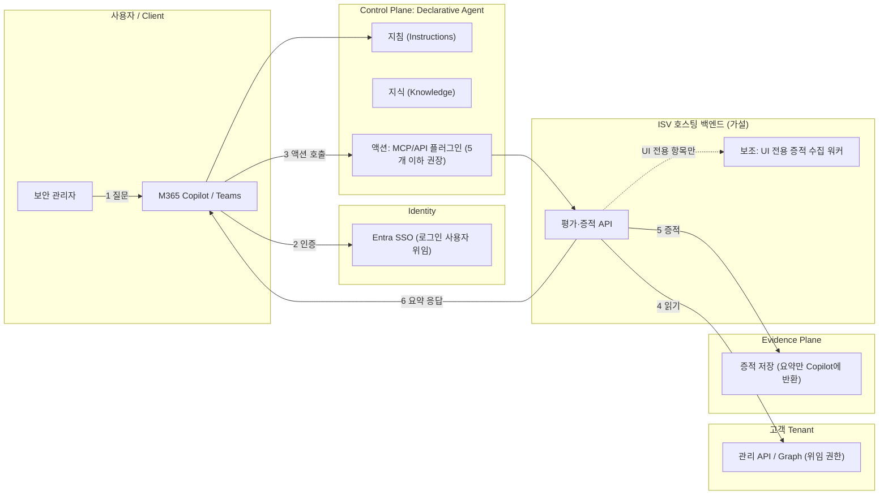

# Microsoft 365 Copilot 게시 경로 분석

## 1. 결정 (사용자 지시, 2026-11-03)
HVE 참여의 Publishing 범주는 **Microsoft 365 Copilot** 방향으로 확정한다. 이전 문서의 "두 경로 중 선택" 열린 질문 중 첫 번째는 닫혔다. 남은 선택은 에이전트 유형(declarative vs custom engine)이다.

## 2. Documented behavior (Microsoft Learn 확인)

| # | 사실 | 출처 |
|---|---|---|
| 1 | Declarative agent = 사용자 지정 지침 + 지식 + 액션. Copilot의 orchestrator와 모델을 쓰며 **추가 호스팅이 필요 없고**, Microsoft 365 컴플라이언스·RAI·보안 표준을 상속한다. | learn.microsoft.com/microsoft-365/copilot/extensibility/agents-overview |
| 2 | Custom engine agent = 자체 orchestration, 자체 모델. **Microsoft 365 밖의 추가 호스팅**(보통 Azure, 추가 비용)이 필요하고 컴플라이언스·RAI·보안은 직접 책임진다. 선제적(proactive) 메시지를 지원한다. | 동일 |
| 3 | Declarative agent는 **사용자가 시작하는 상호작용만** 지원한다(proactive 미지원). 개인 사용 설계. | 동일 (비교표) |
| 4 | 두 유형 모두 "내 조직 내 배포 또는 ISV로서 상용 스토어 게시"가 가능하다. | 동일 |
| 5 | MCP/API 플러그인은 declarative agent의 **액션으로만** 지원되며, 독립 경험으로는 활성화되지 않는다. | .../overview-plugins |
| 6 | 플러그인 인증: Entra SSO, OAuth 2.0 authorization code, API key(API 플러그인만), 익명. 로그인한 사용자를 대신해 자격 증명을 얻는다. | .../plugin-authentication |
| 7 | 플러그인 5개 이하는 항상 프롬프트에 주입, 초과 시 설명 기반 semantic matching. 함수·도구 10개를 넘으면 응답 품질이 떨어질 수 있다. 입출력은 토큰 창 한도로 **큰 콘텐츠가 잘린다**. | .../overview-plugins (Limitations) |
| 8 | Marketplace 게시는 Partner Center의 Microsoft 365 and Copilot 프로그램 등록이 필요하다. **모든 플러그인 패키지가 게시 대상은 아니며**, 패키지 유형·포함 기능·제작 도구·대상 경험이 지원되는지 먼저 확인해야 한다. | .../publish-plugin-publicly |
| 9 | 게시 준비: 검증/테스트를 통과한 정확한 패키지, 프라이버시 성명, 이용 약관, 지원 정보, 고객 설정 안내(라이선스·계정·권한·동의·연결·외부 서비스), 제출·업데이트·지원·보안 대응·폐기를 맡을 소유자. | 동일 |
| 10 | 인증 또는 고객별 데이터 접근이 필요하면 **다른 조직의 고객을 지원하고 각 고객의 접근과 데이터를 적절히 분리**하는지 확인해야 한다. | 동일 |
| 11 | Agent Store 검증 가이드라인: Teams 데스크톱/웹, copilot.microsoft.com, Word의 M365 Copilot에서 동작해야 함(Must fix). SSO 사용 시 Entra 앱 등록에 Office 앱 클라이언트 ID를 Authorized client applications로 추가. 책임 있는 AI 확인 요구. | .../review-copilot-validation-guidelines |
| 12 | 제출은 게시가 아니다. 승인된 오퍼가 Marketplace에서 이용 가능해져야 게시 완료. 관리자 승인이 필요한 경우가 있다. | .../publish-plugin-publicly, isv-publisher-guide |
| 13 | 조직 내 경로: 패키지를 M365 관리 센터에 제출하면 관리자가 요청을 승인해 Agent Store에 게시한다. | microsoft-365/copilot/copilot-agent-store |
| 14 | 개발 환경은 M365 Copilot이 있는 샌드박스 테넌트(TAP 제한 프리뷰) 또는 Copilot 라이선스가 있는 엔터프라이즈 프로덕션 환경이 필요하다. 사이드로딩에는 Custom App Upload Enabled와 Copilot Access Enabled가 필요하다. | 검증 가이드라인, build-api-plugins-existing-api |

**Preview 표시된 항목**: Work IQ Dev Tools(`wiqd`) 명령, Copilot Studio 멀티테넌트 에이전트 게시(preview). GA 기능처럼 전제하지 않는다.

**HVE 문서(Documented)와의 교차**: HVE publishing 문서의 M365 경로(선언형 또는 커스텀 엔진 → 구축·테스트 → Marketplace 게시, 오퍼 유형 "Apps and agents for Microsoft 365 and Copilot")는 위 Learn 내용과 일치한다. 다만 HVE Part 2 기술 트랙은 게시 가정을 "SaaS 또는 Azure Managed Application 모델, M365 에이전트의 보조 경험 여부"로 예시한다. 즉 HVE 자료는 M365 에이전트를 **보조 경험**으로 보는 경향이 있고, 우리는 이를 **주 경험**으로 쓴다. 워크샵 자료를 그대로 따르면 Azure 쪽으로 기울 수 있으므로 의도적으로 보정해야 한다.

## 3. 아키텍처 (개념도, 미검증)

- 위 구조는 Learn의 declarative agent + 플러그인 구조에 우리 주제를 대입한 **Technical inference**다. ISV 백엔드의 호스팅 위치, 고객별 분리 방식, 증적 저장소는 확정되지 않았다.
- Enforcement Point: 변경 권한은 로그인한 사용자의 위임 권한과 고객 테넌트 RBAC. Copilot이 아니다.

## 4. 주제에 미치는 영향 (Technical inference)

| 항목 | 영향 |
|---|---|
| "하네스 Wrapping 패키지" | 스토어에 보이는 제품이 아니다. 에이전트 뒤의 **증적 수집 백엔드**가 된다. 제품은 declarative agent(+플러그인). |
| 브라우저 캡처(Playwright) | 에이전트 내부에서 실행되는 것이 아니라 ISV 백엔드 쪽 보조 워커. 문서에 브라우저 자동화를 선언형 에이전트가 직접 수행한다는 근거는 없음(Unknown). 고객 관리자 세션을 백엔드에서 자동화하는 방식이 SSO 위임 모델 및 검증 가이드라인(보안)에 맞는지는 미확인. |
| 안 A(읽기 전용 평가·증적) | **강화**. 플러그인 읽기 호출 + 위임 권한 + 요약 응답이 자연스럽다. |
| 안 B(자동구성, 쓰기) | **약화**. 로그인 사용자의 관리자 권한으로 변경을 수행하는 구조가 된다. 사용자 승인(Allow once / Always allow), RBAC, 롤백이 더 중요. 후속 마일스톤 유지. |
| 큰 증적(HAR, 스크린샷, 설정 덤프) | 토큰 창 한도로 잘린다. 요약 + 증적 저장소 링크 구조 필요. |
| 함수 개수 | 5개 플러그인, 10개 이하 함수 도구가 품질 기준. API 설계를 거칠게(coarse-grained) 해야 한다. |
| 슬로건 | "자동구성"보다 "Copilot에서 묻고, 증적으로 확인하는 Tenant 보안 구성"이 선언형 에이전트 특성에 맞다 (초안). |

## 5. 열린 결정 (사용자 판단 필요)

| # | 결정 | 선택지 | 기준 |
|---|---|---|---|
| D1 | 에이전트 유형 | Declarative(호스팅 불필요, 사용자 시작형) / Custom engine(선제 알림·장기 작업 가능, 호스팅·RAI 직접 책임) | 정기 점검·드리프트 알림이 MVP에 필요한가 |
| D2 | MVP 범위 | A(읽기 전용)만 / A+B 일부 | 심사·권한 위험 |
| D3 | 백엔드 호스팅 | ISV 호스팅(고객별 분리 필요) / 고객 구독 배포(Managed App 혼합) | 규제 산업 고객 요구 |
| D4 | 수익화 구조 | 별도 SaaS 오퍼 연동 / BYOL | HVE 문서: 에이전트와 백엔드 요금 이중 청구 방지 |

## 6. 사전 조건 (워크샵 전 확인)
- M365 Copilot 라이선스가 있는 개발 테넌트 (또는 TAP 샌드박스)와 사이드로드 권한
- Partner Center의 Microsoft 365 and Copilot 프로그램 등록 가능 여부
- 고객 데이터 없이 합성/공개 자료로 시연 가능한 시나리오

## 7. 검증 계획

| 가설 | 필요 증거 | 최소 검증 |
|---|---|---|
| 읽기 전용 평가 에이전트가 declarative + API 플러그인으로 구현 가능 | 대상 설정의 읽기 API 존재 | [[API-vs-UI-Coverage]] 표 작성 후 Agents Toolkit 샘플로 1개 액션 시연 |
| 증적 응답이 토큰 한도 안에서 유용하다 | 실제 응답 크기 | 요약 응답 길이 측정 |
| 심사 요건 충족 | 검증 가이드라인 전체 + RAI 검증 | 가이드라인 항목별 체크리스트 (이번에는 일부만 읽음) |
| 쓰기 액션이 허용·안전하다 | 승인 UX, RBAC | 후속 마일스톤 |

## 8. Unknown
- 선언형 에이전트가 고객 관리자 포털을 대신 조작하는 구성이 스토어 보안 가이드라인에서 허용되는지
- Agent Store 가격·수수료·수익 배분 (Partner Center가 권위 소스)
- 검증 가이드라인의 보안·액션 시나리오 세부 (이번에는 compatibility 부분만 확인)
- RAI 검증 문서(`rai-validation`) 내용

관련: [[Publishing-Paths]], [[Topic-Fit-Analysis]], [[Decision-001-Publishing-Category]]

---

## 업데이트 2026-11-03: D1 분석 추가
에이전트 유형 비교와 권고는 [[Agent-Type-Decision-D1]]에 정리했다. 핵심: 수익화는 유형이 아니라 연결된 SaaS 오퍼가 정하며, 공통 백엔드를 먼저 만들고 에이전트는 얇은 셸로 둔다.
