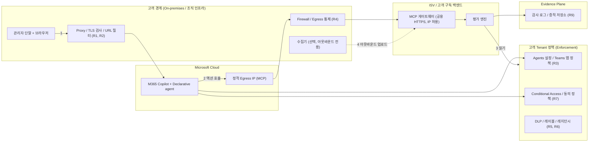

# 조직 인프라에 의한 Cloud Feature 제한: 해소 전략

> **작성 범위**: Microsoft Learn로 확인된 사실(Documented)과 이를 우리 구조(Declarative agent + 백엔드)에 대입한 추론(Inference)으로 작성했다. 금융권 프로젝트에서 **직접 관찰한 사실**은 아직 이 문서에 들어 있지 않다. 그 부분은 [[SME-Observation-Register]]에 본인이 채워야 하며, 채워진 항목만 `Confirmed observation`으로 승격한다. 국내 금융 규제(망분리, 클라우드 이용 절차 등)의 현행 조문은 이번에 확인하지 않았다.

## 1. 결론
1. 제한은 하나가 아니라 **6개 층**(네트워크, 에이전트 거버넌스, 신원, 백엔드 도달성, 데이터, 감사)에서 독립적으로 걸린다. 설정이 풀려 있다고 해서 다른 층이 열려 있다는 뜻이 아니다.
2. 풀이는 "제한을 우회"가 아니라 **제품을 제한에 맞춰 설계하고, 고객 인프라팀·보안팀이 승인할 근거 패키지를 제공**하는 것이다.
3. 핵심 설계 결정 4가지:
   - 기능 의존 최소화: 지침 + 커스텀 액션만 사용 (테넌트 데이터 grounding 미사용)
   - 방화벽 친화 연결: REST API 플러그인보다 **MCP 플러그인**을 우선 (정적 egress IP가 문서화된 쪽)
   - 인바운드를 요구하지 않는 수집기: 고객 경계 안의 수집기는 **아웃바운드 전용**
   - 운영 모드를 단계화(Tier A/B/C)해서 제한이 심한 고객에게도 제공 가능한 형태를 정의
4. 이 영역은 본인의 금융권 경험이 가장 직접 쓰이는 곳이므로, SME 트랙의 핵심 산출물로 두는 것을 권한다.

## 2. 제한의 6개 층

(개념도: 인프라 소스·배포 검증 없음.)

## 3. 제한 카탈로그와 해소 전략

| ID | 제한 | 증상 | 문서 근거 (Documented) | 해소 전략 | 증거 |
|---|---|---|---|---|---|
| R1 | TLS 검사, WSS 차단, 프록시 타임아웃 | Copilot 연동 실패 | Copilot 요구사항: 경계가 WSS를 막거나 TLS 검사가 연결을 방해하거나 프록시가 공격적 타임아웃을 적용하면 연동이 실패할 수 있음 | 고객 네트워크팀에 **예외 요청 패키지** 제공(도메인, 포트, 근거 링크). 이는 고객 인프라 변경이라 우리 제품이 해결하지 않는다. 준비도 게이트로 둔다 | WSS 접속 테스트 결과 |
| R2 | URL 허용 목록에서 `*.cloud.microsoft` 차단 | Copilot 앱 접근 불가 | 도메인 전체 허용 필요, 일부 URL만 허용하는 구성은 미지원 | 예외 요청 패키지에 포함. 개인 계정 로그인 차단 목적이면 tenant restrictions를 대안으로 제시 | 접속 로그 |
| R3 | 에이전트·플러그인 거버넌스 | "Your organization has prevented this agent from being installed" | 관리자 센터 Agents 설정(User access: 모두/없음/특정), 조직 제작 에이전트 허용 토글, Teams 앱 정책, 차단·요청 승인. 관리자는 에이전트의 권한, 데이터 접근, 약관, 프라이버시 성명을 검토 | **관리자용 승인 패키지**(권한 목록, 데이터 흐름, 프라이버시 성명, 호출 액션 목록). 특정 그룹 파일럿 | 관리자 센터 요청/승인 이력 |
| R4 | 백엔드 도달성(Egress 통제) | 액션 호출 실패, 시간 초과 | 원격 MCP 서버는 공개 HTTPS(TLS 1.2 이상)가 전제(`agentConnectors` 경로 문서 기준). MCP 호출은 **정적 egress IP** 목록으로 허용 가능, 목록은 7일 사전 고지로 변경될 수 있고 인증을 대체하지 않으며 로그인·인증 트래픽은 별개 | 백엔드 ingress를 정적 egress IP로 제한 + SSO/OAuth. IP 목록 변경을 자동 추적. 고객 경계 안에서 호출이 필요한 작업은 수집기(아웃바운드 전용)로 분리 | 백엔드 접속 로그의 원본 IP가 목록에 속함 |
| R5 | 외부 서비스 데이터 처리 | 보안·컴플라이언스 반려 | 외부 호스팅 서비스는 자체 신원·권한·프라이버시·컴플라이언스 책임. 비 Microsoft 서비스가 처리하는 데이터는 Microsoft 계약 대상이 아님. 서드파티 플러그인은 데이터가 Microsoft Cloud 신뢰 경계 밖으로 나갈 수 있음 | 데이터 최소화(설정 메타데이터와 판정만, 콘텐츠 비수집), 보존·삭제 정책, 하위 수탁자 공시, 데이터 흐름도, DPA 초안 | 데이터 흐름도, 보존 정책 |
| R6 | 데이터 레지던시, 국가 경계 | 리전 요건 불충족 | Copilot은 Product Terms와 ADR/Multi-Geo 약정 대상. 외부 백엔드는 별도 | 고객별 리전 고정 배포, 증적 저장 위치 명시. 레지던시 약정은 Copilot 부분과 백엔드 부분을 나눠 설명 | 리전 설정 증빙 |
| R7 | Conditional Access, 동의 정책 | SSO 실패, 동의 프롬프트 막힘 | Entra SSO(OBO)는 동의 필요 시 401로 프롬프트를 유도, 앱 등록 요건(Application ID URI, 허용 클라이언트) | 관리자 사전 동의, 최소 권한 목록 제시. **Unknown**: 디바이스 준수 요구 등 CA 조건과 플러그인 OBO의 상호작용 | Entra 로그인 로그 |
| R8 | 관리 API 권한 제한(JIT, PIM 등) | 읽기 호출 거부 | 문서 근거 없음 (가설) | 읽기 전용 권한 집합만 요구. 권한이 없으면 "권한 부족"으로 보고하고 상승을 요구하지 않음 | 오류 응답 |
| R9 | 감사·증적 보존, 관리 분리 | 증적 부족 | Copilot 상호작용은 감사·eDiscovery 대상으로 로깅(Copilot Chat 문서). 외부 서비스의 모니터링·감사는 개발자가 계획해야 함 | 모든 호출에 상관 ID, 증적 불변 저장, 고객 SIEM으로 내보내기 | 로그 샘플 |
| R10 | 기능·클라우드·라이선스 티어 차이 | 일부 기능 미동작 | 정부 클라우드별 Declarative agent 지원 차이, 테넌트 데이터 grounding은 정부 클라우드 미지원, Copilot Chat은 일부 knowledge 소스 제한. 커스텀 액션과 지침은 모든 티어에서 지원으로 표기 | **지침 + 액션만 사용**(knowledge grounding 미사용)해서 티어 의존을 최소화. 지원 클라우드·라이선스를 제품 설명에 명시 | 지원 매트릭스 |

## 4. 운영 모드 (제안)

| 모드 | 조건 | 구성 | 비고 |
|---|---|---|---|
| **A: 표준** | 에이전트 허용, 공용 HTTPS 허용 | Declarative agent + ISV 호스팅 MCP 백엔드 | MVP 기준 |
| **B: 고객 경계 강화** | 외부 SaaS 직접 호출 불가, 인바운드 제한 | Declarative agent + 고객 구독 배포 백엔드(ingress는 정적 egress IP만) + 수집기 아웃바운드 업로드 | D3의 고객 구독 배포 옵션과 연결 |
| **C: Copilot 불가** | 에이전트·플러그인 차단 또는 Copilot 미도입 | Copilot 없이 수집기 + 보고서 가져오기 | HVE/M365 Copilot 게시 범위 밖. 매출 연속성 옵션으로만 기록 |

**Unknown**: 공용 HTTPS를 전혀 허용하지 않는 고객(완전 사설 백엔드)에서 Declarative agent 액션이 가능한지는 문서로 확인하지 못했다. 가능하다고 약속하지 않는다.

## 5. 역할별 담당 (제안)

| 작업 | 담당 |
|---|---|
| 제한 카탈로그와 관찰 사실 등록 ([[SME-Observation-Register]]) | SME (A/R) |
| 운영 모드와 백엔드 배치 설계 (모드 B의 ingress 모델, 수집기) | Architect (R), Tech Lead (A) |
| 정적 egress IP 자동 추적, 수집기 구현 | Engineer |
| 고객 준비도 체크리스트, 승인 패키지, 온보딩 문서 | PM (A), SME (R) |
| 데이터 흐름·보존·하위 수탁자 검토 | Security |

## 6. 검증 계획 (Positive / Negative)

| 가설 | Positive | Negative |
|---|---|---|
| 정적 egress IP 허용만으로 MCP 호출이 성립 | 허용 후 호출 성공, 로그의 원본 IP가 목록에 속함 | 허용 제거 후 호출 실패, 오류 형태 기록 |
| TLS 검사가 Copilot 연동을 방해 | 검사 예외 시 정상 | 검사 적용 시 WSS 오류 재현 |
| 관리자 정책이 설치를 막음 | 허용 후 설치 성공 | User access를 제한하면 설치 오류 재현 |
| 읽기 전용 권한으로 충분 | 필요한 설정 조회 성공 | 권한 제거 시 "권한 부족"으로 보고, 상승 요구 없음 |
| 데이터 최소화가 지켜짐 | 백엔드 저장 항목이 메타데이터와 판정뿐 | 저장소에서 콘텐츠 필드 발견 시 실패 |

모두 합성 데이터·테스트 테넌트에서 실행한다. 고객 환경에서의 결과는 [[SME-Observation-Register]]에 사실로만 기록한다.

## 7. Unknown (현재 근거로 확인할 수 없음)
- 완전 사설 백엔드에서의 Declarative agent 액션 가능 여부
- REST API 플러그인 호출에도 정적 egress가 적용되는지 (문서는 MCP 요청에 적용된다고 명시)
- 디바이스 준수 등 Conditional Access 조건과 플러그인 OBO의 상호작용
- 국내 금융 규제의 현행 요건과 SaaS·클라우드 이용 절차
- 완전 폐쇄망(망분리) 환경에서 Tier C 외 제공 방식

관련: [[M365-Copilot-Path-Analysis]], [[Backend-Work-Breakdown]], [[Customer-Readiness-Checklist]], [[Agent-Type-Decision-D1]]
