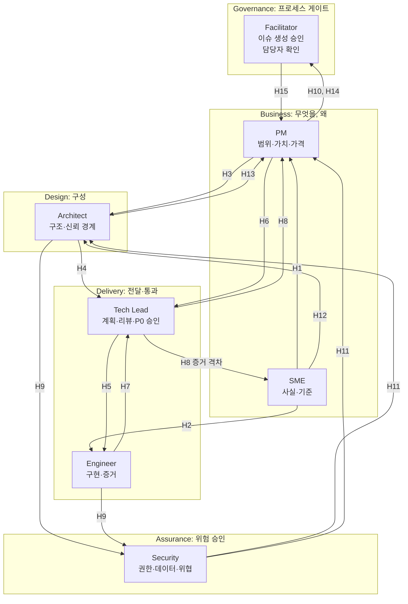
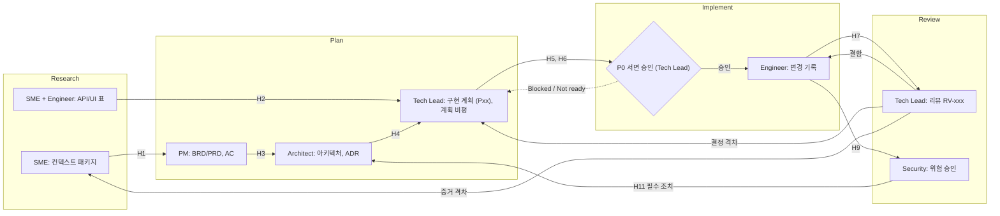

# 초기 팀원 설명 순서

초기 팀원에게 아래 순번대로 설명한다. 앞 항목이 뒤 항목의 전제다. 표시된 "상태"가 `결정`이면 이미 확정된 사항, `제안`이면 이 Vault의 제안, `미정`이면 설명 후 팀이 정해야 하는 사항이다.

## 순서

| 순번 | 설명할 내용 | 핵심 메시지 | 상태 | 참조 |
|---|---|---|---|---|
| 1 | **HVE 프로그램이 무엇인가** | Hypervelocity Engineering. Design Thinking + RPI(Research, Plan, Implement, Review)를 GitHub Copilot 기반 에이전트로 실행. 안정 플랫폼이 아니라 "패턴과 학습의 원천"이며 빠르게 바뀐다. | 결정 | [[README]], [[01_Program-Overview]] |
| 2 | **워크샵이 하는 것과 하지 않는 것** | 약 4시간 30분에 초안 6개를 만든다. 실제 배포, Marketplace 인증, Agent Store 출시 판단은 워크샵 이후 마일스톤이다. | 결정 | [[01_Program-Overview]] |
| 3 | **우리의 목적지** | 게시 범주는 Microsoft 365 Copilot. 스토어에 보이는 제품은 에이전트이고, 수익은 연결된 SaaS 오퍼에서 나온다. | 결정 | [[Decision-001-Publishing-Category]], [[M365-Copilot-Path-Analysis]] |
| 4 | **우리 제품의 모습** | Declarative agent(지침 + 지식 + MCP/API 액션) + ISV 백엔드. 주제는 Tenant MW 보안 구성의 증적 기반 평가. 가치의 본체는 백엔드(결정론적 점검, 증적). | 결정 | [[Decision-002-Agent-Type-Declarative]], [[Agent-Type-Decision-D1]] |
| 5 | **하지 않는 것(비목표)** | 쓰기 자동구성, 선제 알림·정기 점검, Custom engine은 MVP 밖. 바뀌면 계획으로 복귀. | 제안 | [[Backend-Work-Breakdown]], [[Topic-Fit-Analysis]] |
| 6 | **일하는 방식: RPI와 증거 규칙** | 연구→계획→구현→리뷰. 사실, 가정, 결정, 미해결 질문을 분리한다. 신뢰도는 `validated/assumed/unknown/conflicting`. 설정했다는 것과 enforcement를 구분한다. | 결정 | [[Context-Package-Template]], [[SME-Role-Analysis]] |
| 7 | **전체 진행 흐름** | 개요 → 환경 설정 → 역할 트랙 Part 1·2 → 검증 → 게시 준비 → 핸드오프. 되돌아가는 경로(승인 미충족, 추적성 갭, 리뷰 결함)를 함께 본다. | 결정 | [[README]] 진행 Flow, 도식 2 |
| 8 | **역할과 경계** | PM, SME, Architect, Tech Lead, Engineer, Security(파트타임). 누가 무엇을 소유하고 누가 승인하는가. 작성자와 승인자는 분리. | 제안 | [[01_Role-Boundary-Map]], [[RACI-Matrix]], 도식 1 |
| 9 | **겸직 규칙** | PM+SME 겸직 통제, Tech Lead와 Engineer 겸직 시 동료 리뷰, PM은 P0 승인자가 될 수 없다. | 제안 | [[PM-SME-Dual-Hat-Controls]], [[RACI-Matrix]] |
| 10 | **산출물과 저장 위치, 인계 조건** | `.copilot-tracking/` 구조. 경계마다 통과 조건이 있고, 조건 미충족이면 넘기지 않는다. | 제안 | [[02_Artifact-Map]], [[Handoff-Interfaces]], [[Interface-Structure-Map]], 도식 1 |
| 11 | **승인 게이트와 금지 사항** | 에이전트 산출물은 책임자 검토 전까지 초안. 사람 검토 체크박스 대리 금지. 이슈 생성은 퍼실리테이터 승인. 첫 P0는 서면 승인. Blocked/Not ready에서는 구현 시작 금지. | 결정 | [[Governance-Analysis]], 도식 2 |
| 12 | **데이터·기밀 취급** | 워크샵은 합성·공개 자료만 저장소에. 고객·규제·기밀·프로덕션 증거와 자격 증명은 저장소와 프롬프트에 넣지 않는다. 문서에는 placeholder 사용. | 결정 | [[00_README]], [[02_Artifact-Map]] |
| 13 | **설계 제약(팀이 미리 알아야 할 한계)** | 플러그인 5개 이하, 함수·도구 10개 이하 권장, 큰 응답은 토큰 한도로 잘림, MCP 플러그인은 API key 미지원, SSO는 위임(OBO). | 결정 | [[Backend-Work-Breakdown]] 4절 |
| 14 | **환경과 사전 준비** | VS Code, GitHub Copilot, HVE Core All 확장, 워크샵 브랜치. Copilot 라이선스 개발 테넌트와 사이드로드 권한(Custom App Upload, Copilot Access), Partner Center 등록 가능 여부. | 미정 | [[Backend-Work-Breakdown]] WP15 |
| 14-1 | **제한 환경 대응** | 고객의 프록시, TLS 검사, 에이전트 거버넌스, 방화벽, 레지던시가 기능을 막을 수 있다. 제품을 제한에 맞춰 설계하고 고객 승인 패키지를 제공한다. 운영 모드 A/B/C. | 제안 | [[Restricted-Environment-Strategy]], [[Customer-Readiness-Checklist]] |
| 15 | **열린 결정과 Unknown** | D2 MVP 범위, D3 백엔드 호스팅, D4 수익화. Unknown: 퍼실리테이터 역할 범위, 평가 기준 없음, 린터 호환, 브라우저 자동화의 스토어 허용 여부. 누가 언제 결정하는지 지정. | 미정 | [[Decision-002-Agent-Type-Declarative]], [[02_Evidence-Log]] |
| 16 | **위험과 병목** | 인증·동의(WP4), API/UI 커버리지 표(WP2), 개발 환경(WP15)이 선행 병목. 담당자와 기한을 붙인다. | 제안 | [[RACI-Matrix]] |
| 17 | **첫 행동과 커뮤니케이션** | 각자 첫 산출물, 담당자·기한, 의사결정 기록 방식([[Decision-Log-Template]]), 질문 창구. | 미정 | [[Handoff-Interfaces]], [[Decision-Log-Template]] |

## 킥오프 참고 도식

### 도식 1. 역할 경계 인터페이스 (순번 8~10에서 사용)
각 역할이 소유하는 경계와 산출물이 흐르는 방향이다. H-ID의 정의는 [[Interface-Structure-Map]] 6절과 [[Handoff-Interfaces]]에 있다. 슬라이드용 이미지: ![[attachments/interface-structure-roles.png]]

### 도식 2. 단계별 인터페이스와 되돌림 (순번 7, 11에서 사용)
RPI 단계에서 어디서 넘기고, 어디서 승인하고, 문제가 생기면 어디로 돌아가는지 보여 준다. 슬라이드용 이미지: ![[attachments/interface-structure-rpi.png]]

## 설명할 때의 주의
- 순번 1~4는 "무엇을 만드는가", 5~7은 "어떻게 일하는가", 8~11은 "누가 책임지는가", 12~14는 "지켜야 할 규칙과 준비", 15~17은 "아직 정할 것과 시작"이다.
- 이 Vault의 근거는 HVE 문서의 웹 요약본과 Microsoft Learn 검색 결과다. 가격, 게시 요건, 정책은 원문과 Partner Center로 재확인했다고 말하지 않는다. 확인 전이라고 밝힌다.
- 순번 8~9(역할 분리, 겸직 규칙)는 제안이며 HVE 문서는 Tech Lead와 Architect를 한 역할로 둔다. 팀이 합의해야 확정된다.
- 퍼실리테이터 역할 범위는 문서에 상세 정의가 없다. 주최 측 확인이 필요하다.
