# HVE (Hypervelocity Engineering) – 파트너 워크샵 Vault

HVE 파트너 워크샵을 리드하기 위해 역할별 경계, 산출물 소유권, 제출 주제 적합성을 정리한 Obsidian Vault.

- **Vault Root**: `D:\OneDrive - Megazone Cloud Corporation\Study\HVE`
- **원본**: `github.com/jeongaelee/hve-innovation-kr` (출처 목록: [[Source-Index]])
- **상태**: 초안. 웹 페치 요약본 기반이므로 가격·게시 요건·정책은 원문과 Partner Center로 재확인

## 프로그램 한눈에 보기

- 방법론: Design Thinking(발견) + RPI(Research, Plan, Implement, Review)
- 실행 도구: HVE Core 에이전트 (GitHub Copilot + VS Code에서 실행. M365 Copilot 에이전트가 아니므로 Agent Store에 직접 업로드 불가)
- 형태: 약 4시간 30분 워크샵, 핵심 인원 4~6명
- 목적지: HVE 자료는 Azure Managed Application과 M365 Copilot 에이전트 두 경로를 다룬다. **우리 게시 범주는 Microsoft 365 Copilot으로 확정** ([[Decision-001-Publishing-Category]])
- 워크샵 이후 마일스톤: 실제 배포, Marketplace 인증, Agent Store 출시 가능 여부

## 진행 Flow

```mermaid
flowchart TB
    START(["워크샵 시작"])

    subgraph S1["1단계 개요 (30분)"]
        direction TB
        A1["1-1 성과·시나리오·역할·산출물 합의"]
        A2["1-2 첫 출시 범위 초안 (PM)"]
        A1 --> A2
    end

    subgraph S2["2단계 환경 설정 (30분)"]
        direction TB
        B1["2-1 workshop/team-name 브랜치 + HVE Core All 설치 (Tech)"]
        B2{"에이전트와 /rpi 프롬프트가 보이는가"}
        B3["HVE Installer 비활성화 후 Reload Window"]
        B4["2-2 세션 컨텍스트 파일 생성 (증거 경계 기록)"]
        B1 --> B2
        B2 -->|"아니오"| B3
        B3 --> B2
        B2 -->|"예"| B4
    end

    subgraph S3["3-1단계 역할 트랙 Part 1 (45분)"]
        direction TB
        C1["3-1a SME: /rpi-research → 컨텍스트 패키지 + Lean Canvas"]
        C2["3-1b PM: BRD Builder, PRD Builder → BRD/PRD 초안"]
        C3["3-1c Design: AI Discovery Cards, UX UI Designer → 경험 초안"]
        C1 --> C2
        C1 --> C3
    end

    subgraph S4["3-2단계 역할 트랙 Part 2 (45분)"]
        direction TB
        D1["3-2a PM: /rpi-plan → Functional Planner → 백로그 개요"]
        D2{"퍼실리테이터 승인 + 저장소 권한"}
        D3["Backlog Manager 드라이런 → GitHub Issues 생성"]
        D4["3-2b Tech: 아키텍처 노트, Mermaid 다이어그램, ADR, Security Planner"]
        D1 --> D2
        D2 -->|"승인"| D3
        D2 -->|"미승인"| D1
    end

    subgraph S5["4단계 검증 및 솔루션 (30분)"]
        direction TB
        E1["4-1 역할별 2분 요약 발표"]
        E2["4-2 RPI-Plan 추적 매트릭스 (요구사항→구성요소→백로그→테스트→게시 게이트)"]
        E3{"누락·모순·근거 없는 주장·담당자 없는 위험이 있는가"}
        E4["4-3 담당자 지정, 워크샵 자료로 해결 가능한 갭 해소"]
        E5["4-4 팀이 상위 위험 3가지 선정"]
        E1 --> E2 --> E3
        E3 -->|"있음"| E4
        E4 --> E2
        E3 -->|"없음"| E5
    end

    subgraph S6["5단계 Marketplace / Agent Store 준비 (60분)"]
        direction TB
        F1{"5-1 목표 게시 경로"}
        F2["Azure Managed Application: Partner Center → 패키지 → 오퍼 → 인증"]
        F3["M365 Copilot 에이전트: 에이전트 유형 → 구축·테스트 → Agent Store 제출"]
        F4["5-2 상용화·가격 권장안 (PM, 재무·영업 검토 필요, 승인된 가격표 아님)"]
        F5["5-3 미해결 게이트와 담당자 기록 (보안·개인정보·접근성·법무·지원)"]
        F1 -->|"Azure"| F2
        F1 -->|"Copilot"| F3
        F2 --> F4
        F3 --> F4
        F4 --> F5
    end

    subgraph S7["6단계 구현·상용화 핸드오프 (30분)"]
        direction TB
        G1{"계획 또는 PRD가 Blocked / Not ready 인가"}
        G2["6-1 첫 P0 서면 승인 (PM 진행, 책임 담당자 승인)"]
        G3["6-2 /rpi-implement (승인된 첫 작업만, 변경 기록)"]
        G4["6-3 /rpi-review (RV-xxx 발견 사항)"]
        G5{"리뷰 결과"}
        G1 -->|"예"| G0["계획 보강 (/rpi-plan 재실행)"]
        G0 --> G1
        G1 -->|"아니오"| G2 --> G3 --> G4 --> G5
        G5 -->|"결함"| G3
        G5 -->|"결정 격차"| G0
        G5 -->|"증거 격차"| C1
        G5 -->|"적합"| G6["후속 항목 정리, 사람 검토자 PR/마일스톤 승인"]
    end

    DONE(["완료 기준 충족: 6개 초안 산출물 검토, 미해결 가정 식별, 후속 조치별 담당자 지정"])
    POST(["워크샵 이후 마일스톤: Azure 배포, Marketplace 인증, Agent Store 출시 가능 여부"])

    START --> A1
    A2 --> B1
    B4 --> C1
    C2 --> D1
    C3 --> D4
    D3 --> E1
    D4 --> E1
    E5 --> F1
    F5 --> G1
    G6 --> DONE --> POST
```

### 완료 기준 (원문)
1. 6개 초안 산출물 검토
2. 미해결 가정 식별
3. 게시 후속 조치마다 담당자 지정

### 다이어그램 읽는 법
- 번호(1-1, 3-1a ...)는 워크샵 단계와 순서를 가리킨다. 다이아몬드는 판단 지점이다.
- 되돌아가는 화살표는 실패 또는 보강 경로다 (환경 설정 재시도, 이슈 미승인, 추적성 갭, 구현 결함·결정 격차·증거 격차).
- 에이전트 산출물은 책임자가 검토하기 전까지 초안이다.
- 승인 게이트는 3곳이다: 이슈 생성(퍼실리테이터), 첫 P0 구현(책임 담당자 서면), 가격·상업 조건(PM, 재무 등).
- `Blocked` 또는 `Not ready` 상태에서는 `/rpi-implement`를 시작하지 않는다.

## 초기 팀원 설명 순서

팀 킥오프에서 설명할 순서는 [[Kickoff-Briefing-Sequence]]에 순번으로 정리했다.

## Vault 구성

| 폴더 | 내용 |
|---|---|
| [[00_README]] | Vault 사용 규칙, 폴더 맵, 증거 등급 |
| [[01_Role-Boundary-Map]] | 산출물별 소유 역할과 인계 조건 |
| [[01_Program-Overview]] | 프로그램 정의, 일정, 데이터 흐름 |
| [[02_Artifact-Map]] | `.copilot-tracking` 저장 위치 |
| [[SME-Role-Analysis]] | 산업 전문가 |
| [[PM-Role-Analysis]] | PM |
| [[Design-Role-Analysis]] | 디자인·리서처 |
| [[Tech-Role-Analysis]] | 기술·아키텍트 |
| [[Engineer-Role-Analysis]] | 엔지니어 |
| [[Governance-Analysis]] | 승인 게이트, 변경 관리 |
| [[Topic-Fit-Analysis]] | 제출 주제 적합성 |
| [[API-vs-UI-Coverage]] | 설정별 API/UI 커버리지 표 (작성 대기) |
| [[Publishing-Paths]] | 게시 경로 비교 |
| [[M365-Copilot-Path-Analysis]] | 확정된 게시 범주(M365 Copilot) 분석, Learn 근거 |
| [[Decision-001-Publishing-Category]] | 게시 범주 결정 기록 |
| [[Agent-Type-Decision-D1]] | Declarative vs Custom engine 비교, 수익 구조 |
| [[Decision-002-Agent-Type-Declarative]] | 에이전트 유형 결정 (Declarative로 시작) |
| [[Backend-Work-Breakdown]] | 백엔드 + 에이전트 작업 패키지, 마일스톤 |
| [[RACI-Matrix]] | PM / SME / Architect / Tech Lead / Engineer 담당표 |
| [[Handoff-Interfaces]] | 역할 간 인계 조건, 공통 frontmatter 제안 |
| [[Interface-Structure-Map]] | 역할 경계 인터페이스 구조도, 컴포넌트 경계 소유 |
| [[Architect-Responsibilities]] | Architect 담당 범위 |
| [[Tech-Lead-Responsibilities]] | Tech Lead 담당 범위 |
| [[Restricted-Environment-Strategy]] | 조직 인프라에 의한 Cloud Feature 제한 해소 전략 |
| [[SME-Observation-Register]] | 금융권 경험 관찰 사실 등록부 (입력 대기) |
| [[Customer-Readiness-Checklist]] | 고객 도입 전 준비도 체크리스트 |
| [[PM-SME-Dual-Hat-Controls]] | PM+SME 겸직 통제, 경험 매핑 |
| [[02_Evidence-Log]] | 읽은 문서, 미확인 문서, Unknown 목록 |

## 규칙
- 증거 등급: `documented`, `inference`, `hypothesis`, `unknown`
- 사실, 가정, 결정, 미해결 질문을 분리해서 쓴다.
- 고객명, Tenant ID, 계정, IP, 토큰은 기록하지 않고 `<TenantId>` 같은 placeholder를 쓴다.
