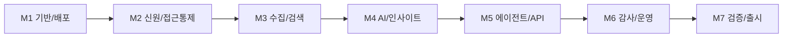

# Relationship Manager Intelligence Experience: 아키텍처 Step-by-Step 가이드

> 상태: draft (개념 아키텍처, 배포 검증 전). `Ref.` 폴더의 기존 아키텍처(보안 관리자 + Declarative agent)는 참고용이며, 이 문서가 새 주제의 기준이다.

## 1. 주제

금융 서비스 파트너가 기업 고객에게 **Relationship Manager(RM) Intelligence Experience**를 제공한다. RM은 Microsoft 365 Copilot에 질문하고 CRM, 이메일, 거래 내역, 내부 지식 소스를 통합한 **계정 인사이트, 위험 지표, 성장 기회, 권장 다음 조치**를 받는다.

| 비기능 요구 | 약속 | 설계 대응 문서 |
|---|---|---|
| 고객별 자체 구독 배포 | Azure Managed Application으로 데이터, 검색, 모델, API, 아이덴티티, 모니터링 배포 | [03](03-Managed-Application.md) |
| 출처 인용 보존 | 모든 주장은 원본 문서/레코드 ID와 연결 | [05](05-Data-and-Search.md), [07](07-API-and-Agent-Contract.md) |
| 계정별 접근 통제 | 사용자가 볼 수 없는 계정 데이터는 검색, 요약, 추천에 나타나지 않음 | [04](04-Identity-and-Access.md) |
| 학습에 고객 데이터 미사용 | 추론 전용 사용, 학습/파인튜닝 금지, 데이터 상주 | [06](06-AI-Safeguards.md) |
| 운영 감사 증거 | 질문, 근거, 접근 결정, 관리 작업의 불변 로그 | [08](08-Observability-and-Audit.md) |

## 2. 문서 지도 (구현 순서)

| # | 문서 | 목적 | 주 독자 |
|---|---|---|---|
| 00 | Overview (이 문서) | 범위, 원칙, 용어, 단계 | 전원 |
| 01 | [Context and Requirements](01-Context-and-Requirements.md) | 이해관계자, 요구사항, 가정, 비목표 | PM, Architect |
| 02 | [System Architecture](02-System-Architecture.md) | 논리/배포/데이터 흐름도, 컴포넌트 책임 | Architect, SE |
| 03 | [Managed Application](03-Managed-Application.md) | 패키징, 배포, 퍼블리셔/고객 경계, Bicep 뼈대 | SE |
| 04 | [Identity and Access](04-Identity-and-Access.md) | Entra SSO/OBO, 계정별 ACL, 보안 트리밍 코드 | SE |
| 05 | [Data and Search](05-Data-and-Search.md) | 수집 파이프라인, 인덱스 스키마, 인용 | SE, 데이터 |
| 06 | [AI Safeguards](06-AI-Safeguards.md) | 프롬프트, 근거 강제, 점수화, 학습 금지 | SE |
| 07 | [API and Agent Contract](07-API-and-Agent-Contract.md) | OpenAPI, Declarative agent 매니페스트 | SE |
| 08 | [Observability and Audit](08-Observability-and-Audit.md) | 로그 스키마, KQL, 불변 보존 | SE, 운영 |
| 09 | [Review and ADR](09-Review-and-ADR.md) | WAF 리뷰, 위협 모델, ADR, 에스컬레이션 | Architect, Tech Lead |
| 10 | [Roadmap and Tracking](10-Roadmap-and-Tracking.md) | 마일스톤, 이슈, 대시보드 연동 | PM, Tech Lead |
| 11 | [Designer Workstream](11-Designer-Workstream.md) | 디자이너 담당 작업, 산출물, 마일스톤 | Designer, PM |

## 3. 설계 원칙

1. **사용자 신원 끝까지 전달**: Copilot, API, 검색, 데이터 모두 로그인한 RM의 신원(OBO)으로 평가한다. 공용 서비스 계정으로 데이터를 읽지 않는다.
2. **근거 없는 답 금지**: 인용이 없는 문장은 응답에 포함하지 않는다(Grounded-only).
3. **고객 구독 안에 데이터 유지**: 퍼블리셔는 제어면(배포/업데이트/지원)만 갖고 고객 데이터 평면에 기본 접근권이 없다.
4. **결정론적 제어, 확률적 생성 분리**: 접근 통제와 점수 계산은 코드로, 문장 생성만 모델로 한다.
5. **증거는 기본값**: 모든 요청에 상관 ID를 부여하고 감사 이벤트를 남긴다.

## 4. 용어

| 용어 | 의미 |
|---|---|
| RM | Relationship Manager. 최종 사용자 |
| Managed App | 고객 구독에 배포되는 Azure Managed Application. 퍼블리셔가 관리 리소스 그룹을 운영 |
| OBO | On-Behalf-Of. 사용자 토큰을 하위 API용 토큰으로 교환하는 흐름 |
| Security trimming | 검색 결과를 사용자 권한으로 필터링 |
| Citation | 응답 문장과 원본 레코드/문서/위치를 잇는 참조 |

## 5. 단계 개요

각 마일스톤의 이슈는 [10](10-Roadmap-and-Tracking.md)과 저장소 루트 `dashboard.html`에서 추적한다.

## 6. 가정과 열린 질문 (확인 필요)

| # | 항목 | 기본 가정 |
|---|---|---|
| Q1 | CRM 종류 | Dynamics 365(Dataverse). Salesforce면 커넥터만 교체 |
| Q2 | 거래 내역 소스 | 고객 보유 Azure SQL/ADLS(읽기 전용 복제) |
| Q3 | 이메일 | Exchange Online, Microsoft Graph 위임 권한 |
| Q4 | 계정 접근 정책 소스 | CRM 계정 팀/소유권 + Entra 그룹 |
| Q5 | 데이터 상주 | 고객 구독 리전 고정 |
