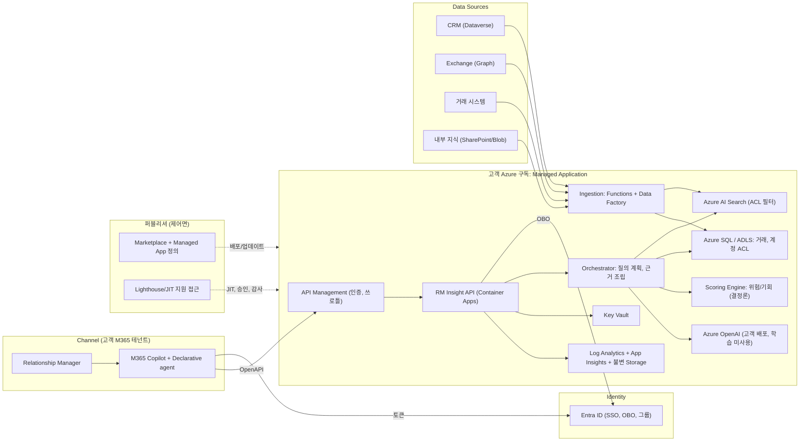
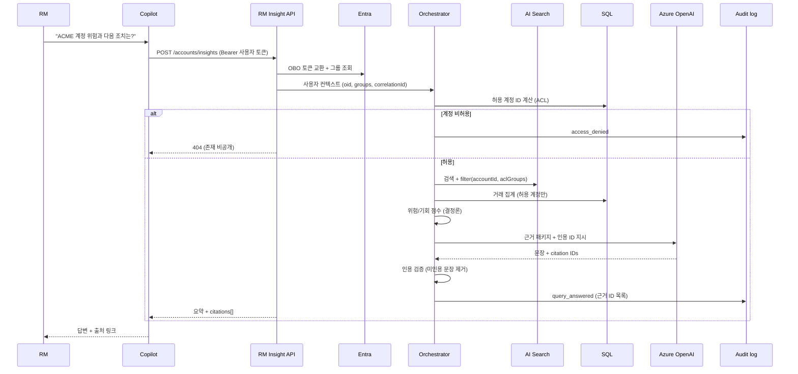

# 02. 시스템 아키텍처

> 개념 아키텍처. 인프라 소스와 배포 검증 전까지 "개념적"으로 취급한다.

## 1. 논리 아키텍처

## 2. 컴포넌트 책임

| 컴포넌트 | 책임 | 구현 기술 |
|---|---|---|
| Declarative agent | 지침, 대화 시작, API plugin 연결 | M365 Agents Toolkit |
| API Management | JWT 검증, 쿼터, 상관 ID 주입 | APIM Standard v2 |
| RM Insight API | 요청 검증, OBO, 응답 구성 | Python FastAPI 또는 .NET Minimal API |
| Orchestrator | 계정 해석, 허용 계정 집합 계산, 검색/조회, 근거 패키지 생성 | 앱 코드 |
| Scoring Engine | 위험/기회 점수 산출(규칙 + 통계), 산식 버전 | 앱 코드 (모델 호출 없음) |
| Azure OpenAI | 근거 패키지를 문장화, 인용 형식 준수 | gpt-4o 계열 배포 |
| AI Search | 하이브리드(키워드+벡터) 검색, ACL 필터 | 인덱스 + 인덱서/푸시 |
| Ingestion | 소스별 정규화, ACL 동기화, 청킹, 임베딩 | Functions, ADF |
| Monitoring | 요청 트레이스, 감사 이벤트, 알림 | Log Analytics, 진단 설정 |

## 3. 요청 흐름 (시퀀스)

## 4. 배포 토폴로지

| 영역 | 소유 | 내용 |
|---|---|---|
| 고객 구독, 고객 RG | 고객 | 데이터 서비스(SQL, ADLS, Search), Key Vault, 네트워크 |
| 고객 구독, 관리 RG | 퍼블리셔(거부 할당으로 보호) | API, Orchestrator, APIM, 모니터링 구성 |
| 퍼블리셔 테넌트 | 퍼블리셔 | 이미지 레지스트리, Managed App 정의, 지원 도구 |

> 결정 필요: 데이터 서비스를 관리 RG(퍼블리셔 운영)에 둘지 고객 RG에 둘지는 [ADR-003](09-Review-and-ADR.md)에서 다룬다. 기본은 **데이터는 고객 RG, 컴퓨트는 관리 RG**.

## 5. 신뢰 경계

1. M365 테넌트 ↔ Azure 구독: Entra 토큰, APIM 검증.
2. 관리 RG ↔ 고객 RG: Managed Identity와 Private Endpoint만 허용.
3. 앱 ↔ 모델: 고객 구독 내 Azure OpenAI, 프롬프트는 **허용된 근거만** 포함.
4. 퍼블리셔 ↔ 고객: JIT 승인, 모든 작업은 고객 로그에 기록.
